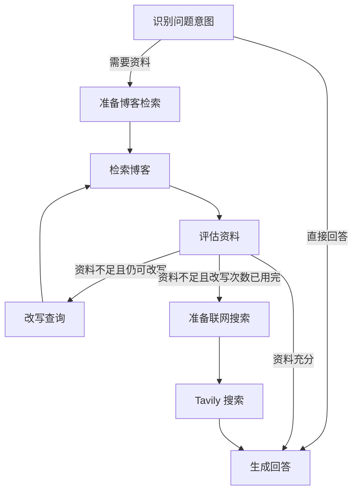

# AI 博客问答

BlogMind 是一个博客阅读与问答应用，使用 React + Ant Design
X 展示对话，通过 FastAPI 和 LangGraph 编排千问嵌入、Qdrant 检索、DeepSeek 回答与 Tavily 网络搜索。

## 当前功能

- 导入博客链接，提取网页正文并分片写入 Qdrant。
- 对问候、助手身份和使用帮助直接回答；需要资料的问题优先检索已导入的博客。
- 评估检索资料，资料不足时改写查询并重新检索，仍不足时转入联网搜索。
- 使用 SSE 流式输出回答，由 `XMarkdown` 渲染正文、`Sources` 展示来源引用。
- 按标题和来源 URL 联合去重，合并同一来源的片段，并统一上下文和引用列表的编号。

## 项目结构

```text
.
├── api.py                         # 配置加载、资源生命周期、导入和流式问答接口
├── blog_rag.py                    # 网页读取、向量存储、引用整理和 LangGraph 工作流
├── requirements.txt               # 后端依赖
├── .env.example                   # 环境变量模板
├── tests/test_references.py        # 引用去重、编号和流式引用测试
└── frontend/
    ├── package.json               # 前端依赖及开发、构建命令
    ├── vite.config.js             # Vite 配置与 API 代理
    ├── src/main.jsx               # 对话界面、导入和问答交互
    ├── src/answerStream.js         # SSE 事件读取及结束标记检查
    ├── src/style.css              # 页面样式
    └── tests/answerStream.test.js  # 流式事件解析测试
```

## 启动

准备 Python 3.10+、Node.js
20.19+ 或 22.12+，以及运行中的 Qdrant 服务。以下命令从项目根目录开始执行。

### 后端

```bash
python3 -m venv .venv
source .venv/bin/activate
pip install -r requirements.txt
cp .env.example .env
```

编辑 `.env`，填写实际使用的模型、服务地址和密钥：

| 环境变量            | 用途                   | 要求                   |
| ------------------- | ---------------------- | ---------------------- |
| `QWEN_MODEL`        | 千问嵌入模型 ID        | 必填                   |
| `QWEN_API_KEY`      | 千问 API 密钥          | 必填                   |
| `QWEN_BASE_URL`     | 千问兼容 API 地址      | 必填                   |
| `DEEPSEEK_MODEL`    | DeepSeek 聊天模型 ID   | 必填                   |
| `DEEPSEEK_API_KEY`  | DeepSeek API 密钥      | 必填                   |
| `DEEPSEEK_BASE_URL` | DeepSeek 兼容 API 地址 | 必填                   |
| `QDRANT_HOST`       | Qdrant HTTP 服务地址   | 必填                   |
| `QDRANT_API_KEY`    | Qdrant API 密钥        | 无鉴权的本地服务可留空 |
| `TAVILY_API_KEY`    | Tavily 网络搜索密钥    | 使用联网搜索时必填     |

服务地址需要包含 `http://` 或 `https://`。配置完成后启动：

```bash
uvicorn api:app --reload
```

后端默认地址为 <http://127.0.0.1:8000>，接口文档位于
<http://127.0.0.1:8000/docs>。启动时会校验配置、调用嵌入服务确认向量维度，并连接 Qdrant；初始化失败时服务不会启动。修改
`.env` 后需要重启后端。

### 前端

在另一个终端进入项目根目录后执行：

```bash
cd frontend
npm install
npm run dev
```

打开 Vite 输出的地址，默认是 <http://localhost:5173>。开发服务器会将 `/api` 请求代理到
`http://127.0.0.1:8000`。

### 构建并由后端提供页面

```bash
cd frontend
npm run build
cd ..
source .venv/bin/activate
uvicorn api:app
```

构建完成后再启动后端，访问 <http://127.0.0.1:8000>。FastAPI 会在启动时检测
`frontend/dist`，并挂载页面和静态资源。

## 使用方式

在输入框中单独发送完整的 HTTP 或 HTTPS 文章链接即可导入；发送其他文字则发起问答。导入成功后会显示写入的片段数量，可以继续询问文章摘要、观点或细节。

- 导入支持无需登录的静态 HTML、XHTML 和纯文本页面，响应体大小上限为 5 MB。
- 网页正文按最多 600 个字符分片，配置的片段重叠长度为 80 个字符。
- 每次博客检索最多返回 5 个片段；联网搜索使用 Tavily advanced 模式，最多返回 5 条结果。
- 未配置 `TAVILY_API_KEY` 时仍可启动，但不能正常使用资料不足后的联网搜索路径。
- 每次请求只向后端提交本次问题；页面中的历史对话不会作为模型上下文传入，也不会持久保存。

首次使用或更换嵌入配置后，需要导入对应的文章。集合名称由嵌入服务地址、模型 ID 和向量维度决定，配置变化时会使用对应集合，原有集合保留。

重复导入相同链接会新增片段；来源引用去重不会删除或合并数据库中的记录。

## 问答流程



当前默认最多改写 1 次，由 `blog_rag.py` 中的 `MAX_REWRITES`
控制。联网搜索使用原始问题，结果直接交给回答节点。意图分类失败时仍走检索路径。

聊天节点通过 `ChatOpenAI`
调用 DeepSeek，当前统一关闭思考模式。分类和资料评分使用结构化输出，回答节点根据资料生成简体中文答案及编号引用。

### 来源引用

`build_references` 以 `(title, source)` 为联合键，其中 `source` 保存来源 URL：

- 标题和 URL 均相同的片段合并为一条引用；仅一个字段相同的来源仍分别保留。
- 引用按首次出现的顺序编号，从 1 开始；同一来源中的相同正文片段只保留一份。
- 模型上下文和流式返回的引用列表共用这套整理逻辑，使用相同的编号。

## API 与流式协议

| 接口               | 请求体                                  | 响应                   |
| ------------------ | --------------------------------------- | ---------------------- |
| `POST /api/import` | `{"url":"https://example.com/article"}` | JSON，`count` 为片段数 |
| `POST /api/ask`    | `{"question":"文章的核心观点是什么？"}` | `text/event-stream`    |

`/api/ask` 通过 LangGraph 的 `messages` 和 `updates` 模式获取生成结果，仅转发 `generate`
节点的正文增量。每个 SSE 事件由 `data:` 开头，以空行分隔：

| 事件         | 数据字段            | 前端处理                   |
| ------------ | ------------------- | -------------------------- |
| `content`    | `type`、`content`   | 将文本增量追加到回答正文   |
| `references` | `type`、`documents` | 保存并展示来源列表         |
| `[DONE]`     | 结束标记，不是 JSON | 结束读取，将消息标记为成功 |

每个 `documents` 条目包含 `index`、`source`、`title` 和
`content`，分别表示引用编号、来源 URL、标题和合并后的正文片段。

`readAnswerStream` 使用 `XStream` 解析 SSE，收到 `[DONE]`
时正常返回。如果流关闭前没有收到该标记，会抛出“流未正常结束”；非法 JSON 也会抛错。前端捕获这些错误后，将对应消息标记为失败。

## 测试与构建

在已安装依赖并激活虚拟环境的项目根目录运行后端测试：

```bash
pip install pytest
python -m pytest -q
```

前端测试和构建命令：

```bash
cd frontend
node --test tests/*.test.js
npm run build
```

现有后端测试覆盖引用去重、内容合并、编号一致性和空结果；前端测试覆盖正文与引用事件、正常结束标记、未完整结束的流和非法 JSON。

这些测试使用本地构造的数据，不调用真实模型、Qdrant 或 Tavily 服务。

## 运行说明

模型和数据库资源在每个后端进程启动时初始化一次，并在进程关闭时释放数据库连接。多进程部署时，每个进程各自初始化资源。本项目面向本地使用，尚未提供身份认证，不应直接暴露到公网。
